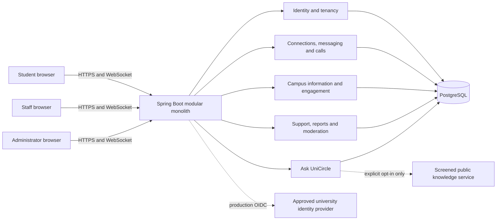
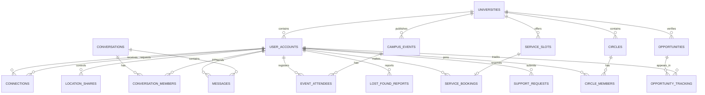
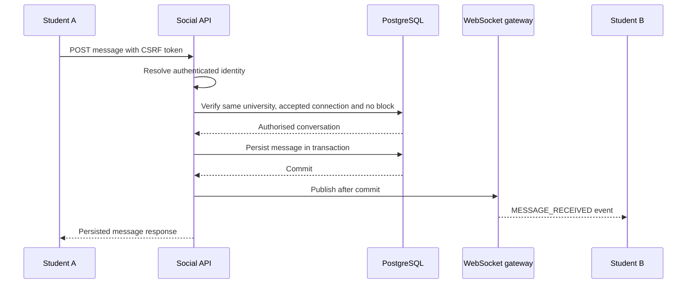
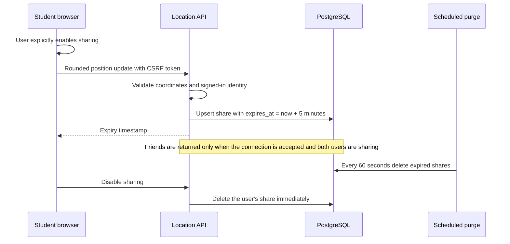
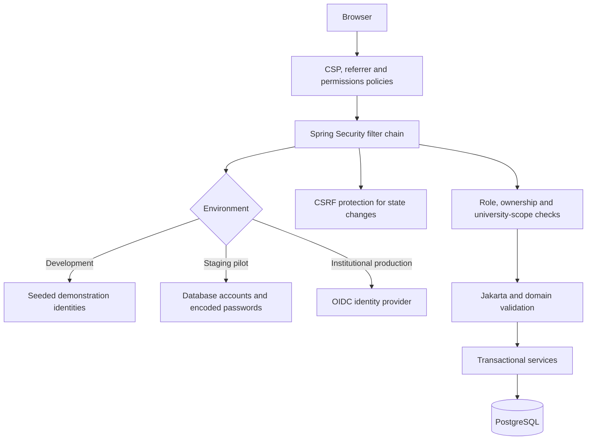

# UniCircle architecture evidence

These diagrams summarise implemented behaviour. The database migrations and automated tests remain the authoritative technical evidence.

## System context

## Core relational model

## Accepted-connection messaging sequence

## Consent-based location sequence

## Production security boundary

